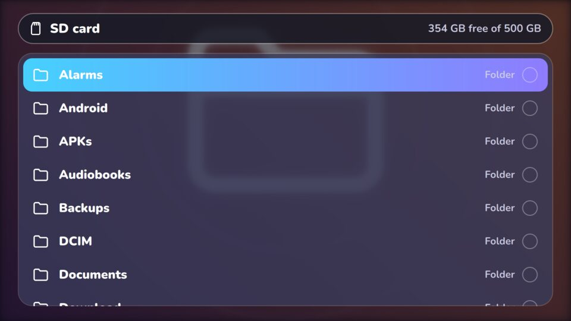

# Asgard OS

A Linux gaming OS for the **AYN Thor**, the dual-screen SM8550 handheld. It's a fork of [ROCKNIX](https://rocknix.org)
that adds:

- **Asgard Home**, its own frontend made for two screens, in place of EmulationStation.
- **Thor support** ROCKNIX lacks: working sleep, both screens, touch, gyro, a charge limit and tuned audio.
- **Settings, an in-game menu and tools** on the device, so the Thor never needs a keyboard or SSH.

**📖 [Read the Asgard OS wiki](https://github.com/AsgardOperationSystem/asgardos/wiki)**: install, every feature with
screenshots, troubleshooting.

> **Experimental.** Asgard is built and tested by one person on one AYN Thor Pro. Installing it replaces the Thor's
> bootloader with OpenABL: read the [Install guide](https://github.com/AsgardOperationSystem/asgardos/wiki/Install)
> whole before you start.

| Top screen | Bottom screen |
|---|---|
|  |  |
|  |  |

| Trophies (RetroAchievements) | Settings | Files (Tools) |
|---|---|---|
|  |  |  |

## Highlights

- **Both screens, used well:** Home on top and a detail card below, games on the right screen, DS and 3DS across
  both, L+R swaps them. Each screen has its own refresh rate, brightness and colour.
- **An in-game menu for every emulator:** quick save and load, screenshot, back to Home with the game frozen,
  performance and sound.
- **Per-system and per-game settings:** emulator, core and options, plus hardware overrides: CPU and GPU caps, fan,
  screens, radios and EQ.
- **Battery:** deep sleep that works, screens-off mode, a charge limit with bypass charging, a battery report.
- **Audio:** a speaker EQ tuned for the Thor, AutoEQ for headphones, Bluetooth headphones with their battery and codec.
- **RetroAchievements and cheats** from Home, and **calibration** for sticks, triggers and touch.
- **Library Manager:** add, rename and delete games from a browser on your network, at
  [its site](https://asgardoperationsystem.github.io/asgard-library-manager/) or `http://<your Thor>:8467`, with
  scraped art and details, after pairing once with a code the Thor shows
  ([how to use it](https://github.com/AsgardOperationSystem/asgardos/wiki/Library-Manager);
  [its repository](https://github.com/AsgardOperationSystem/asgard-library-manager)). New, 🧪.
- **Downloads finish before sleep:** close the lid during an update download or a scrape and the Thor waits, screens
  off, until it's done, then sleeps. New, 🧪.

What works today, feature by feature: **[features](docs/features.md)** and **[emulators](docs/emulators.md)**.

## Get it

1. Download the latest image, **[AsgardOS-SM8550.aarch64-0.0.4.img.gz](https://github.com/AsgardOperationSystem/asgardos/releases/download/v0.0.4/AsgardOS-SM8550.aarch64-0.0.4.img.gz)** ([.sha256](https://github.com/AsgardOperationSystem/asgardos/releases/download/v0.0.4/AsgardOS-SM8550.aarch64-0.0.4.img.gz.sha256)); older
   ones and release notes are on [Releases](https://github.com/AsgardOperationSystem/asgardos/releases).
2. Follow [Install](https://github.com/AsgardOperationSystem/asgardos/wiki/Install): OpenABL, the SD card, internal
   storage, updates and recovery.
3. Everything else, from calibration to Bluetooth headphones, is in the
   [wiki](https://github.com/AsgardOperationSystem/asgardos/wiki).

Out of the box the root password is **`asgardos`**, and SSH, Samba and Syncthing use it. Change it with
`setrootpass <new password>` over SSH, or in `asgard.yml`: every boot applies that setting, so `passwd` alone doesn't
last. `asgard.yml` keeps your Wi-Fi, logins and SSH keys outside the image (start from
[`asgard.yml.example`](asgard.yml.example)); see [asgard.yml](https://github.com/AsgardOperationSystem/asgardos/wiki/Asgard-yml).

## Build it

```
git clone --recurse-submodules https://github.com/AsgardOperationSystem/asgardos.git
cd asgardos && ./build.sh      # docker build of the SM8550 image -> build/target/
```

The repo layout, the kernel ([AsgardOperationSystem/linux](https://github.com/AsgardOperationSystem/linux)), staging
an update on a Thor and working on Asgard Home: [docs/development.md](docs/development.md).

## Docs

| Doc | What's in it |
|---|---|
| [Wiki](https://github.com/AsgardOperationSystem/asgardos/wiki) | User guides: install, every feature, troubleshooting |
| [Features](docs/features.md) · [Emulators](docs/emulators.md) | What works today, and how far each is checked |
| [Supported emulators](docs/supported-emulators.md) | Every system, its ROM folder, extensions and cores |
| [SPEC.md](SPEC.md) | What Asgard is and must stay: features, emulators, development rules |
| [Development](docs/development.md) · [Testing](docs/testing.md) | Building, the kernel, Asgard Home, `./test.sh` |
| [Changes](docs/changes.md) · [Sleep](docs/sleep.md) | Every change on top of ROCKNIX and why; the deep sleep work |
| [Adding an emulator](docs/adding-an-emulator.md) · [Plans](docs/plans/) | The emulator contract; planned work |

## Credits

Asgard stands on other people's work. Check these before solving a Thor or SM8550 problem from scratch:

- **[ROCKNIX](https://github.com/ROCKNIX/distribution)**: the base of Asgard: kernel, device support, build system and
  emulator packages. The Thor's working sleep came from its PR #3126.
- **[Kettle Linux](https://github.com/kettlelinux/kettlelinux)**: its SM8550 kernel patches gave us most of our sleep
  and GPU fixes, and the charge-current control behind the charge limit.
- **[Armada](https://github.com/armada-os/armada)**: its PR #723 found the audio block holding the SoC awake, the last
  step to full SoC sleep.

What came from where: [docs/changes.md](docs/changes.md) and [docs/sleep.md](docs/sleep.md).

## License

Asgard OS is a fork of [ROCKNIX](https://github.com/ROCKNIX/distribution) (forked 2026-10-30 at `7cffc96`), itself a
fork of [JELOS](https://github.com/JustEnoughLinuxOS/distribution/); ROCKNIX's history up to the fork is kept in this
repository. Licenses: [LICENSE.md](LICENSE.md) and each component's own license; original ROCKNIX and JELOS code keeps
its copyright notices.
