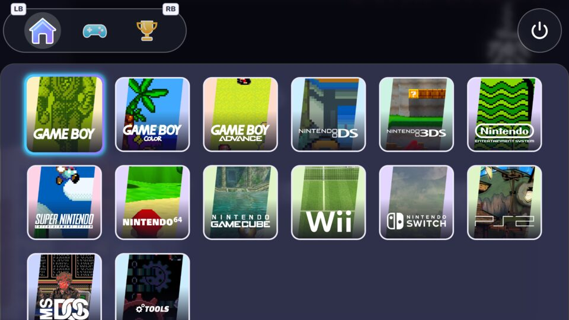
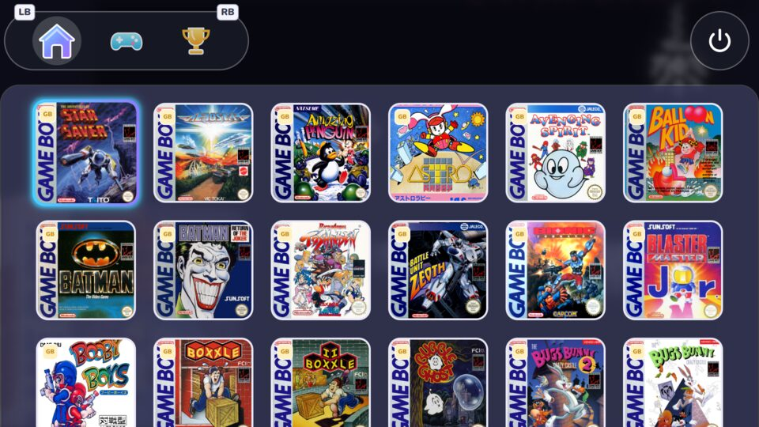

# Asgard OS

A Linux gaming OS for the **AYN Thor**, a dual-screen SM8550 handheld. It's built on
[ROCKNIX](https://rocknix.org) and adds three things:

- **Asgard Home**, its own dual-screen frontend in place of EmulationStation.
- **Thor support** that ROCKNIX lacks: working sleep, both screens, touch, gyro, charge limit and audio tuning.
- **Native settings, an in-game menu and tools**, so the Thor can be used without a keyboard or SSH.

Since 2026-10-30 Asgard is its own fork of ROCKNIX, forked at ROCKNIX `7cffc96` with its full history. The
distribution tree is this repo; ROCKNIX fixes are cherry-picked by hand, never merged wholesale.

## Screenshots

Asgard Home on the Thor, top screen (1920×1080) and bottom screen (1240×1080):

| Top screen | Bottom screen |
|---|---|
|  |  |
|  |  |

| Trophies (RetroAchievements) | Settings | Files (Tools) |
|---|---|---|
|  |  |  |

## Features

✅ works · 🧪 built, not yet tested on the device · ⚠️ partial or with a workaround · ❌ missing or broken ·
⏸️ deferred · 👀 works, being watched

| Feature | Status | Notes |
|---|---|---|
| **Frontend** | | |
| Asgard Home | ✅ | Dual-screen frontend in iiSU's style: grid on top, detail card below, L+R swaps them. Replaces EmulationStation. |
| Settings button | 🧪 | A gear beside the power button in the top bar opens Settings by touch (HOME-6). Host-tested; not checked on a Thor yet. |
| Library and art | ✅ | System art, backdrops, covers, screenshots, play time, Recently played tile. |
| Tile reordering | ✅ | Y or a long press, for consoles and games (saved per console). |
| Trophies (RetroAchievements) | ✅ | Progress per game; ROMs hashed like RA does. Sign-in in Settings. |
| Scraping | ⚠️ | Select → Scrape this game (libretro thumbnails). ScreenScraper is off until a developer ID is set; our own scraper is planned. |
| Cheats | 🧪 | Select → Cheats (or the game's settings page): the game's cheats, on or off per game, applied at its next launch. RetroArch games, from libretro's cheat database in the image; 3DS (Azahar) from Sharkive; PSP (PPSSPP) from its CWCheat database, `.iso`/`.cso`/`.pbp` (not `.chd` yet); DS (melonDS, DraStic, SkyEmu) from libretro's; SkyEmu's GB/GBC from libretro's GameShark codes (none for its GBA). NanoBoyAdvance has no cheats (use RetroArch's mGBA), and the page says the same, with what to use instead, for every other emulator without cheats Asgard can drive; Mednafen (GB/GBC, GBA, NES, SNES, Mega Drive, Master System, Game Gear, PC Engine) from libretro's, decoded; Dreamcast (Flycast) from libretro's; N64 (mupen64plus) from its own database, else libretro's; PS1 (DuckStation) from libretro's, `.bin`/`.cue`/`.iso`/`.m3u` (not `.chd`); Switch (Eden, Eden Duo) from switch-cheats-db, for games whose title ID is in the file name or an NSP's ticket; GameCube/Wii (Dolphin) from Dolphin's own game inis; PS2 (ARMSX2, AetherSX2) from pcsx2_cheats_collection, `.iso`/`.bin`/`.cso` (not `.chd` yet). |
| Back to Home | ✅ | Leave a game without quitting it (frozen, hidden); the first tile returns to it. |
| In-game menu (Home) | ✅ | On the bottom screen: quick save/load, screenshot, restart, quit, plus each emulator's own items (see the emulator table). |
| In-game Wi-Fi and Bluetooth | 🧪 | The menu's Wi-Fi and Bluetooth tile opens Settings' pages drawn as the menu: its header, big tiles, B back (MENU-6). Built, host-tested (offscreen screenshots); not checked on a Thor. |
| In-game Performance tile | ✅ | A game's CPU cap per core type and GPU cap from its in-game menu, saved to the game and applied on leaving the page. Checked on a Thor with the GPU cap in Brilliant Diamond (Eden): raised in game, applied without a restart, and kept in the game's overrides. The CPU rows use the same path but weren't tried there. PPSSPP, ARMSX2, AetherSX2 and Flycast use their own menus, so they don't have it yet. |
| Start on Recently played → Settings | 🧪 | |
| Language | ❌ | English only: Asgard Home has no translations. Since 2026-10-28 Home and everything it starts run in a UTF-8 locale (C.UTF-8). |
| **Settings** | | |
| Wi-Fi | ✅ | Scan, join, on-screen keyboard. |
| Bluetooth | ✅ | Pair a new device scans and lists what's nearby. Checked on a Thor (2026-11-02) with a WH-1000XM4: forgotten, paired again from the page, connected over LDAC, and sound heard after an earlier pairing of it. Pairing a controller from the page hasn't been tried. With the lid closed, music stayed in the headphones without stutter when set to keep Bluetooth on; set off, Bluetooth comes back with the lid and the headphones reconnect with no press (checked by the user, 2026-11-13). After headphones drop during a game, its sound moves to the speaker (checked by the user in Eden, 2026-11-13). |
| Bluetooth device battery | ✅ | Settings > Network > Bluetooth (and the in-game menu's) shows a connected device's battery: BlueZ's for headphones (over HFP: PipeWire's native backend and the kernel's RFCOMM) and BLE pads, the kernel's for DualSense, DualShock 4 and Switch Pro pads (NET-1). Checked on a Thor (2026-11-13) with a WH-1000XM4; pads haven't been tried. |
| Bluetooth audio codec | ✅ | Settings > Network > Bluetooth (and the in-game menu's) shows the codec connected headphones or speakers play over (LDAC, aptX HD, AAC, SBC, or mSBC/CVSD for calls), read from PipeWire, and the device's page switches it with ‹ › between the ones it offers (NET-1). Checked on a Thor (2026-11-13) with a WH-1000XM4: LDAC shown, switching changed the codec and the sound came back on it, the row stays put during a switch, and the choice is kept after the headphones reconnect. |
| VPN | 🧪 | Tailscale (sign-in link on screen), ZeroTier (join by network ID), WireGuard (`.conf` files from the Samba "config" share). Back ends checked 2026-10-28 (tailscaled up and asking for a login, ZeroTier online, a `.conf` imported); the sign-in and join flows from Settings are untested. |
| USB mode, SSH, Samba, Syncthing | ✅ | |
| Date and time, device name | ✅ | |
| Per-emulator settings | ✅ | Default emulator and core per console, ROCKNIX's emulator options (shaders, aspect ratio, Azahar's resolution and layouts...) as settings rows. |
| Per-game settings | ✅ | Emulator, core, the same options, CPU/fan profile and gyro, per game. |
| GPU driver | ✅ | Turnip version selector. The image's Mesa 26.2.6 carries two upstream Turnip fixes from Mesa main: a GPU-hang register value for the A740 and flushes lost across split render passes 🧪. |
| Calibration | ✅ | Touch and sticks. |
| Stick and trigger calibration in Settings | 🧪 | Settings > Hardware > Calibration measures each stick and trigger in Asgard Home itself, then tests it before keeping it; Home exits from any step (CAL-4). GPcal is gone. Host-tested; not checked on a Thor yet. |
| Stick calibration from `asgard.yml` | 🧪 | `asgard.stick_calibration` puts a unit's stick calibration on a fresh install from the first boot; one made on the device wins (CAL-3). Host-tested; not checked on a Thor yet. |
| `asgard.yml` | ✅ | Personal config outside the image (see below). Applied on a real boot 2026-10-28. |
| **Thor Panel and overlays** | | |
| Thor Panel (AYN button) | 🧪 | Status tiles, quick toggles, fan modes, gauges; volume and per-screen brightness with a link lock. The game is frozen while it's open. Rebuilt in Asgard Home's style (`asgard-panel`, 2026-10-28); touch and live toggles not yet checked on the device. |
| Volume/brightness overlay | ✅ | Drawn above games in Asgard Home's style. |
| **Screens and input** | | |
| Dual screens | ✅ | Landscape bottom screen, games placed on the right screen, quiet boot, "ASGARD OS" splash on the top screen. |
| 120 Hz on both screens | ⚠️ | Settings > Display, per screen. The top is fine. The bottom's colours wash out at 120 Hz (about 1.8× brighter, roughly half the saturation) until its panel commands are known, so it defaults to 60. Switch games default to 60 Hz on the top too (no Switch game runs faster, and it halves the top's redraws) 🧪. |
| Full top brightness range | ✅ | The top panel goes to its 12-bit maximum (ROCKNIX stopped ~40 % short). |
| Matched screen colours | ✅ | Per-screen white balance in the display hardware (`asgard-gamma`); the bottom defaults to tint +3, contrast +3, chosen by eye to sit close to the top while keeping shadow detail. It isn't an exact match: matching the top's white measured at tint +10. Adjustable per screen in Settings > Display. |
| OLED Ultra Black, idle blank | ✅ | Ultra Black is on the top panel only and applies after the screen cycles. Burn-in protection: screens off after a timeout, and X turns both off. |
| Touch on both screens | ✅ | Calibrated for the rotated panels. |
| Top screen hang at game launch | ⚠️ | Intermittent. Fewer modesets at launch make it rarer, not proven gone. |
| Bottom screen flicker | ⚠️ | Android's panel timings (`9046`) didn't cure it. |
| Stick lights, fan | ✅ | Fan modes and fixed speeds survive game launches. |
| Gyro (DSU / cemuhook) | ✅ | From the ADSP sensor core; Azahar uses it (aiming in Ocarina of Time 3D works). On per game: it keeps the DSP awake. |
| Gyro for Steam and SDL games | 🧪 | On InputPlumber's virtual DualSense; only tested against a fake InputPlumber. |
| **Power** | | |
| Sleep (s2idle) | ✅ | Full SoC sleep (CX, AOSS, DDR), 20–30 mA (~0.3 %/h). Pad, Wi-Fi, audio and storage resume. Emulators don't replay the time asleep. A lid opened again while it's going down cancels the sleep (checked 2026-11-06). 🧪 The game stays silent through every lid-shut wake, aborted sleeps included (host-tested; not yet checked on a Thor). |
| Sleep drain below ~23 mA | ⏸️ | Same ~22 mA floor on 7.2 and 7.3. Suspects: audio codec rails, devices on vph_pwr. See [docs/sleep.md](docs/sleep.md). |
| Charge limit | ✅ | Stops at the limit, starts again 5 % below. Bypass charging. |
| Charge limit recalibration | 🧪 | Under the limit the gauge drifts (its full capacity up about 50 mAh a day, so 80 % holds more each day); once it's 5 % past the last full charge, the next charge goes to 100 % once, and Settings' Charge limit row says so (PWR-5). Host-tested; not checked on a Thor yet. |
| Battery report | ✅ | What used the battery since the last unplug (sleep, Home, each emulator), time left. |
| CPU cap, performance profiles | ✅ | Per core type, 25–100 %; per-game profiles. |
| **Audio** | | |
| Output follows the headphone jack | ✅ | |
| One volume on every output | 🧪 | Bluetooth headphones, the jack and boot come up at the volume the keys step from, not a level saved for that output (AUD-3, 2026-11-17). Host-tested; not checked on a Thor. |
| Speaker EQ | ✅ | Thor tuning (Android's preset), Joey's preset, or off. |
| Headphone EQ (AutoEQ) | ✅ | Pick a profile by headphone model (~8,850); saved per headphone. |
| Sound in the game menu, bass / mid / treble | 🧪 | EQ profile and ±6 dB tone per output, changed live from the menu or Settings with no gap (SND-7). Built, host-tested; not checked on a Thor. |
| Menu sounds, charger chimes | ✅ | No lag after a pause: outputs stay open 60 s after a sound (checked 2026-11-06). |
| **Storage** | | |
| SD card (UHS-I SDR104, 76 MB/s) | 👀 | Android keeps UHS off as unstable; watch for mmc errors after sleep. |
| UFS (HS-G5, 2.6–2.8 GB/s) | ✅ | |
| Storage page in Settings | 🧪 | Hardware > Storage: free, total and used space inside and on the SD card, where the games folder is, the system partition (SET-5). Built, host-tested; not checked on a Thor yet. |
| **Logs** | | |
| Event log, freeze reports, crash logs | ✅ | In `/storage/.config/thor/`: warnings, errors, kernel oopses, Wi-Fi and sleep events; a report for any boot that never shut down. Sway seat changes aren't logged. |
| GPU `fenced register write` | 👀 | Occasional; no hang seen. |

## Emulators, ports and tools

Every ROCKNIX system is in the image; these are the ones in use and checked on Asgard. **Menu** is what Home opens
in a game.

| System | Default | Also available | Status | Menu | Notes |
|---|---|---|---|---|---|
| Game Boy / Color | RetroArch (Gambatte) | mednafen, SameBoy, mGBA, SkyEmu, ares... | ✅ | Full | |
| Game Boy Advance | RetroArch (mGBA) | NanoBoyAdvance, mednafen, gpSP, SkyEmu... | ✅ | Full | lowerdeck (bottom-screen companion) touch fix 🧪. |
| NES / SNES | RetroArch (Nestopia / Snes9x) | Mesen, FCEUmm, bsnes, mednafen, ares... | ✅ | Full | |
| Nintendo 64 | RetroArch (Mupen64Plus-Next) | gopher64 1.1.42, mupen64plus, ares | ✅ | Full | |
| Nintendo DS | melonDS | DraStic, DSperate 3.0.5, RetroArch cores | ✅ | Resume / Quit | One window per screen, no menu bar. RetroArch's DS cores span both screens ✅ (checked on a Thor 2026-11-14; more testing to come). DraStic and SkyEmu draw one window, on the top screen. |
| Nintendo 3DS | Azahar 2126.2 | | ⚠️ | Full | Screens, layout, HD textures, Force 60 Hz, gyro. Alpha Sapphire at auto resolution freezes the Thor (use 2×). Instant menu 🧪. No geometry shaders on Turnip, as on Android (lighter GPU load, lighting slightly less exact) 🧪. |
| GameCube / Wii | Dolphin 2609 | RetroArch (Dolphin) | ✅ | Resume / Quit | NoGUI on Wayland can't pause. |
| Switch | Eden 0.2.1 | Eden Duo 1.3.2.2 | ✅ | Full | Docked toggle, speed, overlay, GPU options. Tested: TWEWY, Legends Arceus, Legends Z-A, Violet. `.nsz` unsupported. Eden Duo: live companion windows on the bottom screen; its pause under the in-game menu (F4, patch 0005) is built and host-tested, not checked on a Thor yet. Eden's thread priorities (GPU, CPU cores, audio) now take effect on Linux 🧪. A game's controller screen counts the handheld pad as one player, and with only that pad Eden's dialog for it doesn't show, so Echoes of Wisdom no longer asks forever, waits on a greyed-out OK or crashes 🧪. |
| PlayStation 2 | ARMSX2 2.8.4 | AetherSX2 | ✅ | Its own | |
| PSP | PPSSPP | RetroArch (PPSSPP) | 🧪 | Its own | |
| Dreamcast | Flycast | RetroArch (Flycast) | 🧪 | Its own | |
| **Steam** | Steam (ARM64 client) | | ✅ | Full | x86 games through FEX + Proton, in a window on the top screen. Pad settings survive reboots; covers and store details fetched. Tested: Baba Is You, Hollow Knight, Undertale. Can't be paused. |
| **PC** (`.desktop` apps) | | | 🧪 | Resume / Quit | Steam plus native apps. |
| Gen1 Recomp | | | ⚠️ | Resume / Quit | Pokémon Red/Blue/Yellow (LÖVE). No input on native Wayland; runs under XWayland. |
| Wind Waker HD | ZeldaWWHDRecomp 0.3.0 | | ✅ | Its own | Wii U GamePad window on the bottom screen. |
| Dusklight | Twilight Princess port (dual-screen fork) | | ✅ | Resume / Quit | Companion on the bottom screen. |
| Lumi-Dex | | | 🧪 | | Pokédex companion on the bottom screen while Brilliant Diamond runs in Eden. |
| **Tools:** Asgard Music | | gmu | ✅ | | Playlists, screens-off playback. |
| **Tools:** Firefox | Firefox ESR (Mozilla's aarch64 build) | | 🧪 | Resume / Quit | Restores its tabs after Quit. Asgard Keyboard on the bottom screen. Launches full screen on the right screens (checked 2026-10-28). |
| **Tools:** Terminal | QTerminal | | 🧪 | Resume / Quit | Asgard Keyboard (Ctrl, Alt, arrows, symbols) on the bottom screen. Launches full screen on the right screens (checked 2026-10-28). |
| **Tools:** Moonlight | moonlight-qt | | 🧪 | Resume / Quit | Game streaming from a PC. Launches full screen on the right screens (checked 2026-10-28). |
| **Tools:** Files | Asgard Files | | 🧪 | | Internal storage, ROMs, SD card: copy, move, rename, delete. Launches full screen on the right screens (checked 2026-10-28). |

## Layout

```
build.sh          build the image (./build.sh), or stage it on a Thor (./build.sh stage)
test.sh           run the host tests: no Thor, no build, no root
test-device.sh    run the read-only device checks on a Thor over SSH
inject-config.sh  put your asgard.yml on an image's boot partition
distribution/     Asgard OS itself: options, kernel_options, logos, image tools, extra package patches
device/           the board (SM8550): options, config.xml (DTB list), bootloader, rootfs overlay, kernel .config
packages/         every package recipe; ours: asgard/, asgard-home/ (src/), asgardos/;
                  linux/src is the kernel, a submodule (asgardos/linux)
config/ scripts/  the build system (from LibreELEC by way of ROCKNIX, ours now)
tools/            build helpers; tools/turnip/ builds extra Turnip (Vulkan) drivers
docs/             changes, sleep work, adding an emulator, the supported emulators, screenshots
build/            git-ignored: everything the build makes (build dirs, sources, target/ images, log/)
thor/             git-ignored: device notes (ayn_thor_pro.md) and the Thor workspace
```

## Building

```
git clone --recurse-submodules https://github.com/AsgardOperationSystem/asgardos.git
cd asgardos && ./build.sh      # docker build of the SM8550 image -> build/target/ (all output in build/)
```
`./build.sh stage root@<thor>` copies the update to a running Thor; it's applied on the next reboot.

To put Asgard on a Thor, see [Install](https://github.com/AsgardOperationSystem/asgardos/wiki/Install) in the wiki.

## Kernel

The kernel is its own repo, [asgardos/linux](https://github.com/AsgardOperationSystem/linux) (branch `asgard`): Linux
stable plus every Asgard kernel patch and the SM8550 device trees as one commit each. It's a submodule here; the build
copies it as is (no patch files, no tarball). To change the kernel, commit in the submodule, push, and commit the new
submodule pointer here. To move to a new kernel, rebase `asgard` onto the new stable tag (`git rebase --onto v7.3.2
v7.3.1`), fix the conflicts, force-push (allowed on `asgard`), set `PKG_VERSION` in `packages/linux/package.mk`.

To take a fix from ROCKNIX: `git remote add rocknix https://github.com/ROCKNIX/distribution.git` once, then
`git fetch rocknix next` and `git cherry-pick <sha>` (git maps ROCKNIX's `projects/ROCKNIX/...` paths to ours by
rename detection; a conflict means the file moved too far). Until 2026-10-30 Asgard was patches/ +
overlay/ on a pinned ROCKNIX; each old patch is now one commit ("Asgard patch NNNN" in its message).

## Personal config: asgard.yml

Nothing personal is built into the image. Wi-Fi, logins and SSH keys live in `asgard.yml` (start from
`asgard.yml.example`; `asgard.yml` is git-ignored) on the boot partition (`/flash/asgard.yml`, or
`/storage/.config/asgard/asgard.yml` after `installtointernal`). `./inject-config.sh <image> asgard.yml` puts it
on a local copy of an image. At every boot each key is applied unless the setting was changed on the device:
**image defaults < asgard.yml < the user's own changes**. Nothing personal is built into an image: ROCKNIX's `LOCAL_WIFI_SSID`, `LOCAL_WIFI_KEY` and `LOCAL_SSH_KEYS_FILE` are gone
from the recipes, and `build.sh` runs the build with an empty environment.

### Default login

Out of the box the root password is **`asgardos`**. It's public, so change it if SSH, Samba or Syncthing can be reached
from a network you don't trust. The password is the `root.password` setting, and every boot applies it to the root
login, Samba and the Syncthing GUI, so `passwd` alone doesn't last. To change it, either:
- run `setrootpass <new password>` over SSH, or
- set it in `asgard.yml` (`root:` / `password:`), which applies on the next boot.

Asgard Home's Settings has no row for it yet.

## Gyro: ADSP sensors root

The gyro and accelerometer (SH5001) live in the ADSP's sensor core. `thor-sensorspd.service` (hexagonrpcd) serves
it a HexagonFS root that can't ship in the image (Android blobs plus this unit's calibration). Copy it to
`/storage/.config/asgard/sensors-root/` once: `hexagonrpc.json`, `dsp/` from the Thor's `dsp_a`,
`vendor/etc/sensors`, `vendor/lib/rfsa/adsp`, `odm/etc`, a writable copy of `persist/sensors`, and `socinfo/`.
The service starts only when it's there.

## Developing Asgard Home

Qt Quick on the image's Qt 6, two windows: top 1920×1080 (grid, dock) and bottom 1240×1080 (detail card, hints).
- `backend.cpp`: library from ROCKNIX's `es_systems.cfg`, ROM dirs and ES-DE-format scraped media; play time;
  launching through `runemu.sh`; the pad from evdev (the Thor's Nintendo layout: A east, B south).
- `qml/`: `Main.qml` (state and navigation), `HeroCard`, `Tile`, `Dock`, `Settings`, `GameMenu`, small parts.
- `dev.sh shot ["keys"]` renders both screens offscreen on the desktop; `THOR=root@<thor> dev.sh thor ["keys"]`
  cross-builds, copies to the Thor and renders there. The screenshots above come from running the installed
  `asgard-home` with `ASGARD_SHOT`/`ASGARD_KEYS` on the Thor.

## Credits and projects to learn from

Asgard stands on other people's work. Check these projects before solving a Thor or SM8550 problem from scratch.

- **[ROCKNIX](https://github.com/ROCKNIX/distribution)**: the base of Asgard. Its kernel, device support, build
  system, emulator packages and per-emulator options are what the image is made of, and the Thor's working sleep
  came from its PR #3126.
- **[Kettle Linux](https://github.com/kettlelinux/kettlelinux)** (SteamOS userspace on mainline, targets the Thor
  and Odin 2 Portal): its well-documented SM8550 kernel patch stack gave us most of our sleep and GPU fixes (GPU
  boot DDR vote, open UARTs and UFS clocks in s2idle, AudioReach suspend, GMU HFI), the MCU rail and fan quieting
  in sleep, the UFS PHY reference-clock fix, and the charge-current control behind our charge limit.
- **[Armada](https://github.com/armada-os/armada)** (Fedora bootc with ROCKNIX-derived device support): its
  PR #723 found the audio block holding the SoC awake, the last step to full SoC sleep (`9047`), and its sleep and
  charger work confirmed how we handle IPCC and the USB-C unplug during sleep.

Which patch came from where, and why: [docs/changes.md](docs/changes.md). What we compared and found:
[docs/sleep.md](docs/sleep.md).

## More docs

- [Installing](https://github.com/AsgardOperationSystem/asgardos/wiki/Install) (wiki): OpenABL first, then the SD card, internal storage, updates and recovery.
- [Specification](SPEC.md): what Asgard is, its features and emulators, and its development constraints.
- [Testing](docs/testing.md): how we check it, and `./test.sh`.
- [Changes on top of ROCKNIX](docs/changes.md): every patch, what was broken and why.
- [Sleep](docs/sleep.md): the deep sleep work, and what we took from Kettle Linux and Armada.
- [Adding an emulator](docs/adding-an-emulator.md): what every new emulator has to support, with a test for each.
- [Supported emulators](docs/supported-emulators.md): every system, with its ROM folder, extensions and cores (generated by the build).
- [Plans](docs/plans/): work that's planned or under way.
- [Old merge requests](docs/merge-requests.md): an archive of the first 45 changes.

## License

Asgard OS is a fork of [ROCKNIX](https://github.com/ROCKNIX/distribution) (forked 2026-10-30 at `7cffc96`), which
is itself a fork of [JELOS](https://github.com/JustEnoughLinuxOS/distribution/); ROCKNIX's history up to the fork
is kept in this repository. Licenses: [LICENSE.md](LICENSE.md) and each component's own license; original ROCKNIX
and JELOS code keeps its copyright notices.
