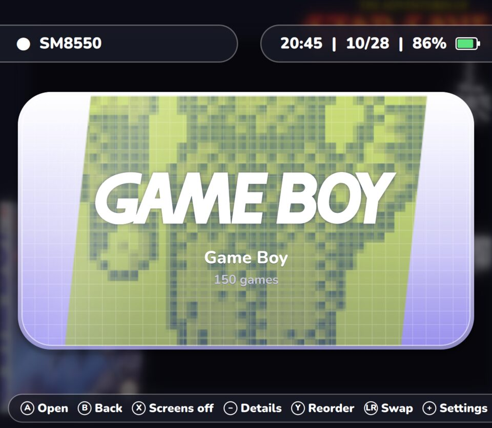
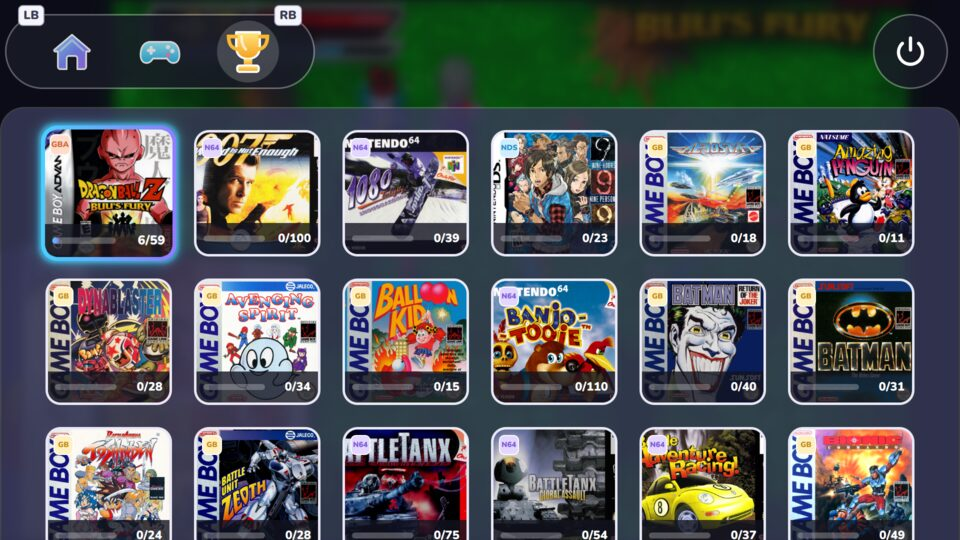
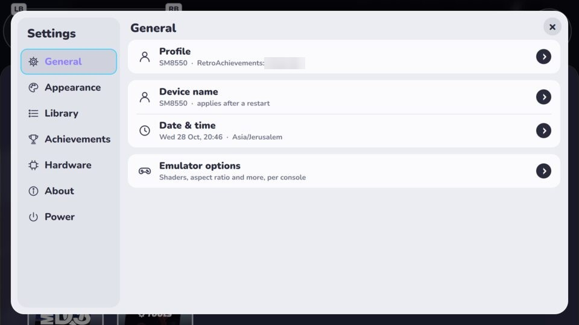

# Asgard OS

A Linux gaming OS for the **AYN Thor**, a dual-screen SM8550 handheld. It's built on
[ROCKNIX](https://rocknix.org) and adds three things:

- **Asgard Home**, its own dual-screen frontend in place of EmulationStation.
- **Thor support** that ROCKNIX lacks: working sleep, both screens, touch, gyro, charge limit and audio tuning.
- **Native settings, an in-game menu and tools**, so the Thor can be used without a keyboard or SSH.

ROCKNIX is a pinned submodule. Asgard is a stack of patches and new files on top of it, so following ROCKNIX is
a pin bump plus fixing whichever patch stops applying.

## Screenshots

Asgard Home on the Thor, top screen (1920×1080) and bottom screen (1240×1080):

| Top screen | Bottom screen |
|---|---|
|  |  |
|  |  |

| Trophies (RetroAchievements) | Settings | Files (Tools) |
|---|---|---|
|  |  |  |

## Features

### Asgard Home
- A dual-screen frontend styled after iiSU. The grid is on the top screen and the detail card on the bottom one;
  L+R swaps them.
- Library from ROCKNIX's systems, with system art, backdrops, covers and screenshots, play time, and a Recently
  played tile.
- Emulator and core per console and per game, plus ROCKNIX's emulator options (shaders, aspect ratio, Azahar's
  resolution and layouts...) as settings rows.
- **Trophies** tab: RetroAchievements progress per game (ROMs hashed like RA does).
- Touch on the bottom screen, tile reordering (Y or a long press), menu sounds.
- **Back to Home:** leave a game without quitting it (frozen and hidden); the first tile returns to it.
- **Scrape this game** (Select): cover and screenshot from libretro thumbnails.
- **In-game menu** on Home, on the bottom screen: quick save/load, screenshot, restart, quit, plus per-emulator
  items (Azahar screens/layout/textures, Eden docked mode and speed, RetroArch menu, Steam overlay).

### Systems
- **Emulators** from ROCKNIX (RetroArch, Azahar, melonDS, Dolphin, PPSSPP, ARMSX2...), with dual-screen layouts for
  DS and 3DS.
- **Switch:** Eden v0.2.1 built from source, handheld mode. Keys and firmware come from the card's `bios/NSO/`.
- **Steam:** Valve's ARM64 client, with x86 games through FEX and Proton. It runs in a window on the top screen, so
  the Thor's buttons keep working. Covers and store details are fetched for installed games, and Steam's pad
  settings survive reboots.
- **PC:** Steam plus native ports as `.desktop` apps (Gen1 Recomp, the LÖVE Pokémon Red/Blue/Yellow port).
- **Tools:** Asgard Music, Firefox, Terminal, Moonlight and Asgard Files, with an on-screen keyboard on the bottom
  screen.

### Settings and the Thor Panel
- **Settings** (Start): Wi-Fi, Bluetooth, VPNs (Tailscale, ZeroTier, WireGuard), USB mode, SSH/Samba/Syncthing,
  stick lights, fan, CPU cap, charge limit, sleep mode, audio EQ, battery report, updates, date and time.
- **Thor Panel** (AYN button): status tiles, fan modes, and volume and brightness per screen. The game is frozen
  while it's open.
- A volume/brightness overlay drawn in Asgard Home's style above games.

### Thor hardware
- **Sleep that works** (s2idle). The whole SoC powers down (CX, AOSS and DDR), and the drain is about 20–30 mA
  (~0.3 %/h). The pad, Wi-Fi, audio and storage all resume.
- **Both screens:** landscape bottom screen, games on the right screen, 60 Hz top panel, OLED Ultra Black, idle
  blank (burn-in protection), and X turns both screens off.
- **Touch on both screens**, calibrated for the rotated panels.
- **Gyro:** the accelerometer and gyro are read from the ADSP sensor core and served as a DSU (cemuhook) motion
  source. Azahar uses it (aiming in Ocarina of Time 3D works). It's on per game, since it keeps the DSP awake.
- **Charge limit:** charging stops at the limit and starts again 5 % below it.
- **Fast storage:** SD card at UHS-I SDR104 (76 MB/s), UFS at HS-G5 (2.6–2.8 GB/s).
- **Audio:** the output follows the headphone jack. The speaker EQ is tuned from Android's preset, or Joey's. For
  headphones, an AutoEQ profile can be picked by model and is saved per headphone. Charger in/out chimes.
- **Battery report:** what used the battery since the last unplug (sleep, Home, each emulator), and the time left.
- **Boot splash** "ASGARD OS" on the top screen, and a quiet boot.

### System
- **Personal config in `asgard.yml`**, not in the image (see below).
- **Persistent event log** in `/storage/.config/thor/`: warnings, errors, kernel oopses, Wi-Fi and sleep events,
  and a log for any boot that never shut down cleanly.

## Missing or partial

| Feature | State | Notes |
|---|---|---|
| Tools system (Firefox, Terminal, Moonlight, Files) | 🧪 Untested | Built and installed, not yet checked on the device. |
| PC system (`.desktop` apps) | 🧪 Untested | Steam inside works; other apps launch directly. |
| VPNs (Tailscale, ZeroTier, WireGuard) | 🧪 Untested | In Settings → Hardware → Network. |
| Home in Azahar opens the menu at once | 🧪 Untested | It used to take ~1.2 s; a second press closed it. |
| Start on the Recently played tile → Settings | 🧪 Untested | |
| RetroArch bottom screen off | 🧪 Untested | Settings → Display. |
| lowerdeck touch (GB/GBA bottom-screen companion) | 🧪 Untested | Tested in code only. |
| `asgard.yml` | 🧪 Untested | Self-test passes; not yet applied on a real boot. |
| Gyro for Steam and SDL games | 🧪 Partial | Sent to InputPlumber's virtual DualSense; only tested against a fake InputPlumber. |
| Top screen hang at game launch | ⚠️ Partial | Intermittent. Fewer modesets at launch make it rarer, but it isn't proven gone. |
| Bottom screen flicker | ⚠️ Partial | Android's panel timings (`9046`) didn't cure it. |
| Pokémon Alpha Sapphire at auto 3DS resolution | ❌ Broken | Freezes the Thor (a GPU/display hang). Workaround: that game at 2×. |
| gen1recomp on native Wayland | ⚠️ Workaround | No input under SDL3's Wayland backend; runs under XWayland. |
| Thor Panel | ⚠️ Partial | Labels don't scale well; a rebuild in Asgard Home's style is planned. |
| ScreenScraper | ⚠️ Partial | Wired in but off until a developer ID is set; our own scraper is planned. |
| Language (`system.language`) | ❌ Missing | No locale generation; ROCKNIX's EmulationStation did it. |
| Sleep drain below ~23 mA | ⏸️ Deferred | The rest is board-level (panels, touch, pad MCU, LEDs, Wi-Fi chip, PMIC). |
| Event log: sway seat changes | ❌ Missing | Not logged. |
| GPU `fenced register write` | 👀 Watching | Occasional; no hang seen. |
| SD card at SDR104 | 👀 Watching | Android keeps UHS off as unstable; watch for mmc errors after sleep. |

## Layout

```
rocknix/          ROCKNIX (submodule, branch next, pinned)
patches/          changes to ROCKNIX files, applied in order
overlay/          new files copied over the tree (kernel patches, packages, Asgard Home)
build.sh          prepare rocknix/ and build the image (./build.sh [prepare|upgrade|stage])
inject-config.sh  put your asgard.yml on an image's boot partition
frontend/         -> Asgard Home's source (overlay/projects/ROCKNIX/packages/asgard-home/src)
docs/             changes, sleep work, adding an emulator, screenshots
thor/             git-ignored: device notes (ayn_thor_pro.md) and the Thor workspace
```

## Building

```
git clone --recurse-submodules https://github.com/AsgardOperationSystem/asgardos.git
cd asgardos && ./build.sh      # ROCKNIX's docker build of the SM8550 image -> rocknix/target/
```
`./build.sh prepare` only resets `rocknix/`, applies `patches/` and copies `overlay/`.
`./build.sh stage root@<thor>` copies the update to a running Thor; it's applied on the next reboot.

To upgrade ROCKNIX:
```
./build.sh upgrade          # pin -> latest next, then apply patches
# a failing patch: fix the file in rocknix/, regenerate that patch with git -C rocknix diff, rerun
git add rocknix patches && git commit -m "ROCKNIX <date>"
```

## Personal config: asgard.yml

Nothing personal is built into the image. Wi-Fi, logins and SSH keys live in `asgard.yml` (start from
`asgard.yml.example`; `asgard.yml` is git-ignored) on the boot partition (`/flash/asgard.yml`, or
`/storage/.config/asgard/asgard.yml` after `installtointernal`). `./inject-config.sh <image> asgard.yml` puts it
on a local copy of an image. At every boot each key is applied unless the setting was changed on the device:
**image defaults < asgard.yml < the user's own changes**. Never build with ROCKNIX's `LOCAL_WIFI_SSID` /
`LOCAL_WIFI_KEY` / `LOCAL_SSH_KEYS_FILE`; they bake secrets into the image (`build.sh` runs the build with an empty
environment, so nothing from your shell reaches it).

## Gyro: ADSP sensors root

The gyro and accelerometer (SH5001) live in the ADSP's sensor core. `thor-sensorspd.service` (hexagonrpcd) serves
it a HexagonFS root that can't ship in the image (Android blobs plus this unit's calibration). Copy it to
`/storage/.config/asgard/sensors-root/` once: `hexagonrpc.json`, `dsp/` from the Thor's `dsp_a`,
`vendor/etc/sensors`, `vendor/lib/rfsa/adsp`, `odm/etc`, a writable copy of `persist/sensors`, and `socinfo/`.
The service starts only when it's there.

## Developing Asgard Home

Qt Quick on the image's Qt 6, two windows: top 1920×1080 (grid, dock) and bottom 1240×1080 (detail card, hints).
- `backend.cpp`: library from ROCKNIX's `es_systems.cfg`, ROM dirs and ES-DE-format scraped media; play time;
  launching through `runemu.sh`; the pad from evdev (the Thor's Nintendo layout: A east, B south).
- `qml/`: `Main.qml` (state and navigation), `HeroCard`, `Tile`, `Dock`, `Settings`, `GameMenu`, small parts.
- `dev.sh shot ["keys"]` renders both screens offscreen on the desktop; `THOR=root@<thor> dev.sh thor ["keys"]`
  cross-builds, copies to the Thor and renders there. The screenshots above come from running the installed
  `asgard-home` with `ASGARD_SHOT`/`ASGARD_KEYS` on the Thor.

## More docs

- [Changes on top of ROCKNIX](docs/changes.md): every patch, what was broken and why.
- [Sleep](docs/sleep.md): the deep sleep work, and what we took from Kettle Linux and Armada.
- [Adding an emulator](docs/adding-an-emulator.md): what every new emulator has to support, with a test for each.
