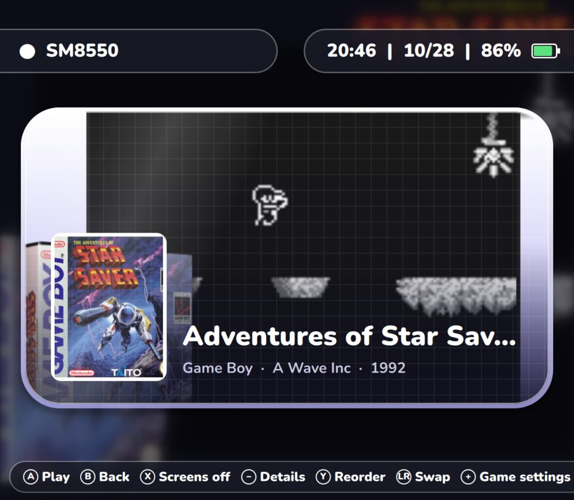

# Asgard OS

A Linux gaming OS for the **AYN Thor**, a dual-screen SM8550 handheld. It's built on
[ROCKNIX](https://rocknix.org) and adds three things:

- **Asgard Home**, its own dual-screen frontend in place of EmulationStation.
- **Thor support** that ROCKNIX lacks: working sleep, both screens, touch, gyro, charge limit and audio tuning.
- **Native settings, an in-game menu and tools**, so the Thor can be used without a keyboard or SSH.

ROCKNIX is a pinned submodule. Asgard is a stack of patches and new files on top of it, so following ROCKNIX is
a pin bump plus fixing whichever patch stops applying.

## Screenshots

Asgard Home on the Thor, top screen (1920×1080) and bottom screen (1240×1080):

| Top screen | Bottom screen |
|---|---|
|  |  |
|  |  |

| Trophies (RetroAchievements) | Settings | Files (Tools) |
|---|---|---|
|  |  |  |

## Features

✅ works · 🧪 built, not yet tested on the device · ⚠️ partial or with a workaround · ❌ missing or broken ·
⏸️ deferred · 👀 works, being watched

| Feature | Status | Notes |
|---|---|---|
| **Frontend** | | |
| Asgard Home | ✅ | Dual-screen frontend in iiSU's style: grid on top, detail card below, L+R swaps them. Replaces EmulationStation. |
| Library and art | ✅ | System art, backdrops, covers, screenshots, play time, Recently played tile. |
| Tile reordering | ✅ | Y or a long press, for consoles and games (saved per console). |
| Trophies (RetroAchievements) | ✅ | Progress per game; ROMs hashed like RA does. Sign-in in Settings. |
| Scraping | ⚠️ | Select → Scrape this game (libretro thumbnails). ScreenScraper is off until a developer ID is set; our own scraper is planned. |
| Back to Home | ✅ | Leave a game without quitting it (frozen, hidden); the first tile returns to it. |
| In-game menu (Home) | ✅ | On the bottom screen: quick save/load, screenshot, restart, quit, plus each emulator's own items (see the emulator table). |
| Start on Recently played → Settings | 🧪 | |
| Language | ❌ | English only: Asgard Home has no translations. Since 2026-10-28 Home and everything it starts run in a UTF-8 locale (C.UTF-8). |
| **Settings** | | |
| Wi-Fi | ✅ | Scan, join, on-screen keyboard. |
| Bluetooth | ✅ | |
| VPN | 🧪 | Tailscale (sign-in link on screen), ZeroTier (join by network ID), WireGuard (`.conf` files from the Samba "config" share). Back ends checked 2026-10-28 (tailscaled up and asking for a login, ZeroTier online, a `.conf` imported); the sign-in and join flows from Settings are untested. |
| USB mode, SSH, Samba, Syncthing | ✅ | |
| Date and time, device name | ✅ | |
| Per-emulator settings | ✅ | Default emulator and core per console, ROCKNIX's emulator options (shaders, aspect ratio, Azahar's resolution and layouts...) as settings rows. |
| Per-game settings | ✅ | Emulator, core, the same options, CPU/fan profile and gyro, per game. |
| GPU driver | ✅ | Turnip version selector. |
| Calibration | ✅ | Touch and sticks. |
| `asgard.yml` | ✅ | Personal config outside the image (see below). Applied on a real boot 2026-10-28. |
| **Thor Panel and overlays** | | |
| Thor Panel (AYN button) | 🧪 | Status tiles, quick toggles, fan modes, gauges; volume and per-screen brightness with a link lock. The game is frozen while it's open. Rebuilt in Asgard Home's style (`asgard-panel`, 2026-10-28); touch and live toggles not yet checked on the device. |
| Volume/brightness overlay | ✅ | Drawn above games in Asgard Home's style. |
| **Screens and input** | | |
| Dual screens | ✅ | Landscape bottom screen, games placed on the right screen, quiet boot, "ASGARD OS" splash on the top screen. |
| 120 Hz on both screens | ✅ | Settings > Display, per screen (bottom defaults to 60). |
| Full top brightness range | ✅ | The top panel goes to its 12-bit maximum (ROCKNIX stopped ~40 % short). |
| Matched screen colours | ✅ | Per-screen white balance in the display hardware (`asgard-gamma`); the bottom is corrected to the top's white and contrast by default. |
| OLED Ultra Black, idle blank | ✅ | Burn-in protection; X turns both screens off. |
| Touch on both screens | ✅ | Calibrated for the rotated panels. |
| Top screen hang at game launch | ⚠️ | Intermittent. Fewer modesets at launch make it rarer, not proven gone. |
| Bottom screen flicker | ⚠️ | Android's panel timings (`9046`) didn't cure it. |
| Stick lights, fan | ✅ | Fan modes and fixed speeds survive game launches. |
| Gyro (DSU / cemuhook) | ✅ | From the ADSP sensor core; Azahar uses it (aiming in Ocarina of Time 3D works). On per game: it keeps the DSP awake. |
| Gyro for Steam and SDL games | 🧪 | On InputPlumber's virtual DualSense; only tested against a fake InputPlumber. |
| **Power** | | |
| Sleep (s2idle) | ✅ | Full SoC sleep (CX, AOSS, DDR), 20–30 mA (~0.3 %/h). Pad, Wi-Fi, audio and storage resume. Emulators don't replay the time asleep. |
| Sleep drain below ~23 mA | ⏸️ | The rest is board-level (panels, touch, pad MCU, LEDs, Wi-Fi chip, PMIC). |
| Charge limit | ✅ | Stops at the limit, starts again 5 % below. Bypass charging. |
| Battery report | ✅ | What used the battery since the last unplug (sleep, Home, each emulator), time left. |
| CPU cap, performance profiles | ✅ | Per core type, 25–100 %; per-game profiles. |
| **Audio** | | |
| Output follows the headphone jack | ✅ | |
| Speaker EQ | ✅ | Thor tuning (Android's preset), Joey's preset, or off. |
| Headphone EQ (AutoEQ) | ✅ | Pick a profile by headphone model (~8,850); saved per headphone. |
| Menu sounds, charger chimes | ✅ | |
| **Storage** | | |
| SD card (UHS-I SDR104, 76 MB/s) | 👀 | Android keeps UHS off as unstable; watch for mmc errors after sleep. |
| UFS (HS-G5, 2.6–2.8 GB/s) | ✅ | |
| **Logs** | | |
| Event log, freeze reports, crash logs | ✅ | In `/storage/.config/thor/`: warnings, errors, kernel oopses, Wi-Fi and sleep events; a report for any boot that never shut down. Sway seat changes aren't logged. |
| GPU `fenced register write` | 👀 | Occasional; no hang seen. |

## Emulators, ports and tools

Every ROCKNIX system is in the image; these are the ones in use and checked on Asgard. **Menu** is what Home opens
in a game.

| System | Default | Also available | Status | Menu | Notes |
|---|---|---|---|---|---|
| Game Boy / Color | RetroArch (Gambatte) | mednafen, SameBoy, mGBA, SkyEmu, ares... | ✅ | Full | |
| Game Boy Advance | RetroArch (mGBA) | NanoBoyAdvance, mednafen, gpSP, SkyEmu... | ✅ | Full | lowerdeck (bottom-screen companion) touch fix 🧪. |
| NES / SNES | RetroArch (Nestopia / Snes9x) | Mesen, FCEUmm, bsnes, mednafen, ares... | ✅ | Full | |
| Nintendo 64 | RetroArch (Mupen64Plus-Next) | gopher64 1.1.42, mupen64plus, ares | ✅ | Full | |
| Nintendo DS | melonDS | DraStic, DSperate 3.0.5, RetroArch cores | ✅ | Resume / Quit | One window per screen, no menu bar. |
| Nintendo 3DS | Azahar 2126.2 | | ⚠️ | Full | Screens, layout, HD textures, Force 60 Hz, gyro. Alpha Sapphire at auto resolution freezes the Thor (use 2×). Instant menu 🧪. |
| GameCube / Wii | Dolphin 2609 | RetroArch (Dolphin) | ✅ | Resume / Quit | NoGUI on Wayland can't pause. |
| Switch | Eden 0.2.1 | Eden Duo 1.3.2.2 | ✅ | Full | Docked toggle, speed, overlay, GPU options. Tested: TWEWY, Legends Arceus, Legends Z-A, Violet. `.nsz` unsupported. Eden Duo: live companion windows on the bottom screen. |
| PlayStation 2 | ARMSX2 2.8.4 | AetherSX2 | ✅ | Its own | |
| PSP | PPSSPP | RetroArch (PPSSPP) | 🧪 | Its own | |
| Dreamcast | Flycast | RetroArch (Flycast) | 🧪 | Its own | |
| **Steam** | Steam (ARM64 client) | | ✅ | Full | x86 games through FEX + Proton, in a window on the top screen. Pad settings survive reboots; covers and store details fetched. Tested: Baba Is You, Hollow Knight, Undertale. Can't be paused. |
| **PC** (`.desktop` apps) | | | 🧪 | Resume / Quit | Steam plus native apps. |
| Gen1 Recomp | | | ⚠️ | Resume / Quit | Pokémon Red/Blue/Yellow (LÖVE). No input on native Wayland; runs under XWayland. |
| Wind Waker HD | ZeldaWWHDRecomp 0.3.0 | | ✅ | Its own | Wii U GamePad window on the bottom screen. |
| Dusklight | Twilight Princess port (dual-screen fork) | | ✅ | Resume / Quit | Companion on the bottom screen. |
| Lumi-Dex | | | 🧪 | | Pokédex companion on the bottom screen while Brilliant Diamond runs in Eden. |
| **Tools:** Asgard Music | | gmu | ✅ | | Playlists, screens-off playback. |
| **Tools:** Firefox | Firefox ESR (Mozilla's aarch64 build) | | 🧪 | Resume / Quit | Restores its tabs after Quit. Asgard Keyboard on the bottom screen. Launches full screen on the right screens (checked 2026-10-28). |
| **Tools:** Terminal | QTerminal | | 🧪 | Resume / Quit | Asgard Keyboard (Ctrl, Alt, arrows, symbols) on the bottom screen. Launches full screen on the right screens (checked 2026-10-28). |
| **Tools:** Moonlight | moonlight-qt | | 🧪 | Resume / Quit | Game streaming from a PC. Launches full screen on the right screens (checked 2026-10-28). |
| **Tools:** Files | Asgard Files | | 🧪 | | Internal storage, ROMs, SD card: copy, move, rename, delete. Launches full screen on the right screens (checked 2026-10-28). |

## Layout

```
rocknix/          ROCKNIX (submodule, branch next, pinned)
patches/          changes to ROCKNIX files, applied in order
overlay/          new files copied over the tree (kernel patches, packages, Asgard Home)
build.sh          prepare rocknix/ and build the image (./build.sh [prepare|upgrade|stage])
inject-config.sh  put your asgard.yml on an image's boot partition
frontend/         -> Asgard Home's source (overlay/projects/ROCKNIX/packages/asgard-home/src)
docs/             changes, sleep work, adding an emulator, screenshots
thor/             git-ignored: device notes (ayn_thor_pro.md) and the Thor workspace
```

## Building

```
git clone --recurse-submodules https://github.com/AsgardOperationSystem/asgardos.git
cd asgardos && ./build.sh      # ROCKNIX's docker build of the SM8550 image -> rocknix/target/
```
`./build.sh prepare` only resets `rocknix/`, applies `patches/` and copies `overlay/`.
`./build.sh stage root@<thor>` copies the update to a running Thor; it's applied on the next reboot.

To upgrade ROCKNIX:
```
./build.sh upgrade          # pin -> latest next, then apply patches
# a failing patch: fix the file in rocknix/, regenerate that patch with git -C rocknix diff, rerun
git add rocknix patches && git commit -m "ROCKNIX <date>"
```

## Personal config: asgard.yml

Nothing personal is built into the image. Wi-Fi, logins and SSH keys live in `asgard.yml` (start from
`asgard.yml.example`; `asgard.yml` is git-ignored) on the boot partition (`/flash/asgard.yml`, or
`/storage/.config/asgard/asgard.yml` after `installtointernal`). `./inject-config.sh <image> asgard.yml` puts it
on a local copy of an image. At every boot each key is applied unless the setting was changed on the device:
**image defaults < asgard.yml < the user's own changes**. Never build with ROCKNIX's `LOCAL_WIFI_SSID` /
`LOCAL_WIFI_KEY` / `LOCAL_SSH_KEYS_FILE`; they bake secrets into the image (`build.sh` runs the build with an empty
environment, so nothing from your shell reaches it).

## Gyro: ADSP sensors root

The gyro and accelerometer (SH5001) live in the ADSP's sensor core. `thor-sensorspd.service` (hexagonrpcd) serves
it a HexagonFS root that can't ship in the image (Android blobs plus this unit's calibration). Copy it to
`/storage/.config/asgard/sensors-root/` once: `hexagonrpc.json`, `dsp/` from the Thor's `dsp_a`,
`vendor/etc/sensors`, `vendor/lib/rfsa/adsp`, `odm/etc`, a writable copy of `persist/sensors`, and `socinfo/`.
The service starts only when it's there.

## Developing Asgard Home

Qt Quick on the image's Qt 6, two windows: top 1920×1080 (grid, dock) and bottom 1240×1080 (detail card, hints).
- `backend.cpp`: library from ROCKNIX's `es_systems.cfg`, ROM dirs and ES-DE-format scraped media; play time;
  launching through `runemu.sh`; the pad from evdev (the Thor's Nintendo layout: A east, B south).
- `qml/`: `Main.qml` (state and navigation), `HeroCard`, `Tile`, `Dock`, `Settings`, `GameMenu`, small parts.
- `dev.sh shot ["keys"]` renders both screens offscreen on the desktop; `THOR=root@<thor> dev.sh thor ["keys"]`
  cross-builds, copies to the Thor and renders there. The screenshots above come from running the installed
  `asgard-home` with `ASGARD_SHOT`/`ASGARD_KEYS` on the Thor.

## Credits and projects to learn from

Asgard stands on other people's work. Check these projects before solving a Thor or SM8550 problem from scratch.

- **[ROCKNIX](https://github.com/ROCKNIX/distribution)**: the base of Asgard. Its kernel, device support, build
  system, emulator packages and per-emulator options are what the image is made of, and the Thor's working sleep
  came from its PR #3126.
- **[Kettle Linux](https://github.com/kettlelinux/kettlelinux)** (SteamOS userspace on mainline, targets the Thor
  and Odin 2 Portal): its well-documented SM8550 kernel patch stack gave us most of our sleep and GPU fixes (GPU
  boot DDR vote, open UARTs and UFS clocks in s2idle, AudioReach suspend, GMU HFI), the MCU rail and fan quieting
  in sleep, the UFS PHY reference-clock fix, and the charge-current control behind our charge limit.
- **[Armada](https://github.com/armada-os/armada)** (Fedora bootc with ROCKNIX-derived device support): its
  PR #723 found the audio block holding the SoC awake, the last step to full SoC sleep (`9047`), and its sleep and
  charger work confirmed how we handle IPCC and the USB-C unplug during sleep.

Which patch came from where, and why: [docs/changes.md](docs/changes.md). What we compared and found:
[docs/sleep.md](docs/sleep.md).

## More docs

- [Changes on top of ROCKNIX](docs/changes.md): every patch, what was broken and why.
- [Sleep](docs/sleep.md): the deep sleep work, and what we took from Kettle Linux and Armada.
- [Adding an emulator](docs/adding-an-emulator.md): what every new emulator has to support, with a test for each.
